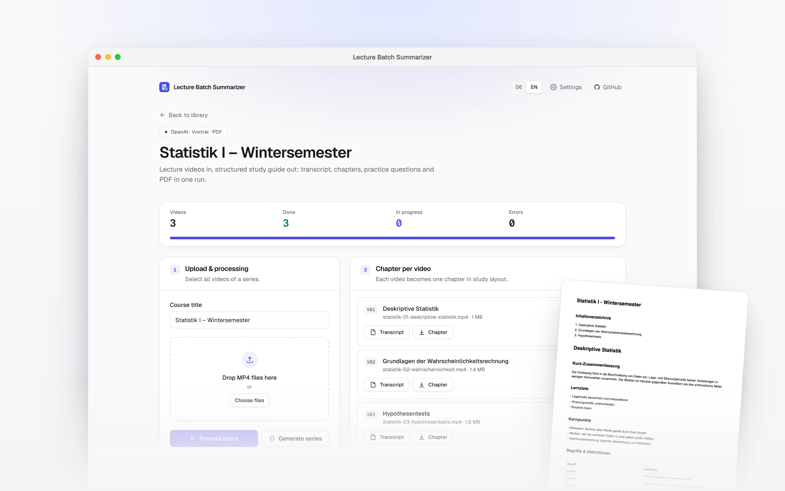
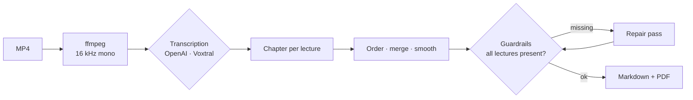
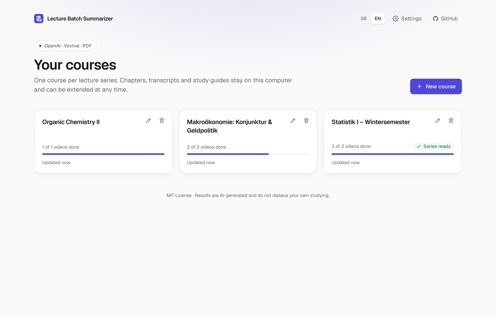
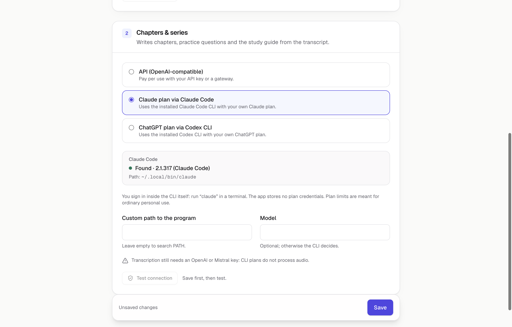

<p align="center">
  
</p>

<p align="center">A free, open-source desktop app that turns lecture recordings into study guides</p>

<p align="center">
  <a href="https://github.com/amroeser/lecture-notes-app/releases/latest"></a>
  <a href="https://github.com/amroeser/lecture-notes-app/actions/workflows/ci.yml"></a>
  <a href="LICENSE"></a>
</p>

<h1 align="center">Hours of lectures in.<br/>One study guide out.</h1>

<p align="center">
  Drop in a semester's worth of recordings. You get a transcript, a structured chapter per lecture<br/>
  and one polished study guide with practice questions, ready as Markdown or PDF.
</p>

<p align="center">
  <a href="https://github.com/amroeser/lecture-notes-app/releases/latest/download/LectureBatchSummarizer-mac-arm64.dmg"><picture><source media="(prefers-color-scheme: dark)" srcset="docs/media/readme/download-mac-arm64-dark.png"></picture></a>
  <a href="https://github.com/amroeser/lecture-notes-app/releases/latest/download/LectureBatchSummarizer-win-x64-setup.exe"><picture><source media="(prefers-color-scheme: dark)" srcset="docs/media/readme/download-windows-dark.png"></picture></a>
</p>

<p align="center"><sub>
  Also for <a href="https://github.com/amroeser/lecture-notes-app/releases/latest/download/LectureBatchSummarizer-mac-x64.dmg">Intel Macs</a> ·
  as a <a href="https://github.com/amroeser/lecture-notes-app/releases/latest/download/LectureBatchSummarizer-win-x64.zip">portable Windows .zip</a> ·
  <a href="#run-from-source">from source</a> ·
  <a href="https://github.com/amroeser/lecture-notes-app/releases/latest">all downloads</a>
</sub></p>

<p align="center">
  <picture>
    <source media="(max-width: 600px) and (prefers-color-scheme: dark)" srcset="docs/media/readme/hero-phone-dark.webp" />
    <source media="(max-width: 600px)" srcset="docs/media/readme/hero-phone-light.webp" />
    <source media="(prefers-color-scheme: dark)" srcset="docs/media/readme/hero-dark.webp" />
    
  </picture>
</p>

<p align="center"><sub>Your courses stay on your computer. Each run sends audio and text to the AI you choose, and only to that one.</sub></p>

<br/>

## See it work

<p align="center">
  <a href="docs/media/demo-en.mp4"></a>
</p>
<p align="center"><sub>▶ Watch as MP4: <a href="docs/media/demo-en.mp4">English</a> · <a href="docs/media/demo-de.mp4">Deutsch</a></sub></p>

## How it works

1. **Create a course.** One course per lecture series. It keeps everything you process in it.
2. **Drop in the recordings.** Each MP4 is transcribed and turned into a chapter with the same study layout: summary, learning objectives, key points, glossary, examples, common mistakes and practice questions with answers.
3. **Get the study guide.** Chapters are ordered by learning progression, merged and smoothed. A guardrail check makes sure no lecture went missing, then Markdown and PDF are ready.

Add next week's lecture to the same course later. It continues as `V04` and the study guide is rebuilt with it.



## Quick answers

- **Is it free?** Yes. The app is MIT-licensed and needs no account with us. You pay only your AI provider, if it charges you.
- **Which AI does it use?** Transcription runs on **OpenAI** (`gpt-4o-mini-transcribe`) or **Mistral Voxtral** (`voxtral-small-transcribe-3`) with your API key. Chapters and the study guide run on any **OpenAI-compatible API**, including your company's gateway, or on your **Claude** or **ChatGPT** plan. [All the ways in](#bring-your-own-ai).
- **Can I use my Claude or ChatGPT plan?** For chapters and the study guide, yes: the app calls the official `claude` (Claude Code) or `codex` CLI that you installed and signed in to yourself. It never asks for, reads or stores your plan credentials. Plan limits are meant for ordinary personal use. Transcription still needs an OpenAI or Mistral key, because neither CLI processes audio.
- **Where is my data?** Courses, transcripts, chapters and study guides are files on your computer. API keys are encrypted with your system keychain. [Where your data goes](#where-your-data-goes).
- **How long can a lecture be?** Long recordings are split into segments automatically (10 minutes for OpenAI, 30 for Voxtral) and joined in order. Each OpenAI segment gets the end of the previous one as context.
- **Which languages?** The app speaks English and German and follows your system language. Lectures are transcribed as German, and the study layout is German.
- **Why does macOS or Windows warn me?** The installers are not code-signed yet. [Install notes](#install).

## A library for every lecture series

<p align="center">
  <picture>
    <source media="(prefers-color-scheme: dark)" srcset="docs/media/desktop-library-en-dark.png" />
    
  </picture>
</p>

Each course shows how many lectures are done and whether its study guide is ready. Rename a course in place, delete it with a confirmation, or open it to add the next recordings. A lecture that failed stays in the course and runs again when you drop the same file in.

## The study guide

<table>
  <tr>
    <td width="58%" valign="top">
      <picture>
        <source media="(prefers-color-scheme: dark)" srcset="docs/media/preview-en-dark.png" />
        
      </picture>
      <p><sub><b>Preview, edit, check.</b> Read the rendered guide, edit the Markdown, and see the guardrail report.</sub></p>
    </td>
    <td width="42%" valign="top">
      
      <p><sub><b>Print-ready PDF.</b> A4 with headings, lists, tables and a new page per chapter.</sub></p>
    </td>
  </tr>
</table>

<details>
<summary><b>The chapter layout</b></summary>

```markdown
# Kapitel: Hypothesentests

## Kurz-Zusammenfassung
Ein Hypothesentest prüft, ob beobachtete Daten mit einer Nullhypothese vereinbar sind …

## Lernziele
## Unterkapitel
## Kernpunkte
## Begriffe & Definitionen
| Begriff | Definition |
|---|---|
| p-Wert | Wahrscheinlichkeit für mindestens so extreme Daten unter H₀ |

## Beispiele
## Typische Fehler/Missverständnisse
## Prüfungs-/Übungsfragen mit Antworten
1. Frage: Was misst der p-Wert?
   Antwort: …
```

</details>

## Bring your own AI

<p align="center">
  <picture>
    <source media="(prefers-color-scheme: dark)" srcset="docs/media/desktop-settings-en-dark.png" />
    
  </picture>
</p>

Open **Settings** in the app. Two choices, set independently:

| Step | Options | What you need |
|---|---|---|
| **Transcription** | OpenAI · Mistral Voxtral | An API key. Optional: a base URL for an OpenAI-compatible gateway. |
| **Chapters & study guide** | API (OpenAI-compatible) · Claude plan via Claude Code · ChatGPT plan via Codex CLI | An API key or gateway, **or** the [Claude Code](https://github.com/anthropics/claude-code) or [Codex](https://github.com/openai/codex) CLI, installed and signed in (run `claude` and log in, or `codex login`). |

**Test connection** checks the key against the provider, or the CLI's version. Keys are shown as *set* or *not set* and never displayed again.

## Install

**macOS.** Open the DMG and drag the app to *Applications*. The app is not notarized yet, so the first start is blocked: Control-click the app, choose **Open**, then **Open** again, or allow it under *System Settings → Privacy & Security*. If macOS says the app is damaged, clear the download flag once:

```bash
xattr -dr com.apple.quarantine "/Applications/Lecture Batch Summarizer.app"
```

**Windows.** Run the installer. SmartScreen shows *Windows protected your PC* for unsigned apps: choose **More info → Run anyway**. The portable `.zip` runs without installing.

On start the app checks GitHub for a newer release and links to it. It does not update itself.

### Run from source

Requires Node.js 22 or 24 and [ffmpeg](https://ffmpeg.org/).

```bash
git clone https://github.com/amroeser/lecture-notes-app.git
cd lecture-notes-app
npm install
cp .env.example .env.local   # set OPENAI_API_KEY (or another provider, see below)
npm run dev                  # web app on http://localhost:3000
npm run desktop:dev          # or the desktop app
npm run desktop:dist         # build an installer for this platform
```

## Where your data goes

| What | Where |
|---|---|
| Courses, chapters, transcripts, study guides | `library/<course>/course.json` in the app's data folder (`LBS_DATA_DIR` when run from source, default `.data/`) |
| Cache of processed lectures | The app's cache folder (`CACHE_DIR`), keyed by file hash, model and prompt version, so re-runs cost nothing |
| API keys | Encrypted with the system keychain (macOS Keychain, Windows DPAPI) in the app's settings |
| Your audio and text | Sent only to the providers you picked, under their terms |

The app runs its local server on `127.0.0.1` with a random port. Every API call needs a token created for that launch, so other programs and web pages cannot use it.

<details>
<summary><b>All environment variables</b> (for running from source)</summary>

| Variable | Default | Purpose |
|---|---|---|
| `TRANSCRIBE_PROVIDER` | `openai` | `openai` or `mistral` |
| `OPENAI_API_KEY` | | Key for OpenAI transcription and, by default, for text |
| `OPENAI_BASE_URL` | OpenAI | OpenAI-compatible base URL |
| `OPENAI_TRANSCRIBE_MODEL` | `gpt-4o-mini-transcribe` | Transcription model (OpenAI) |
| `OPENAI_TRANSCRIBE_CHUNK_SECONDS` | `600` | Segment length for audio above 24 MB |
| `MISTRAL_API_KEY` | | Key for Voxtral |
| `MISTRAL_BASE_URL` | `https://api.mistral.ai/v1` | Mistral base URL |
| `MISTRAL_TRANSCRIBE_MODEL` | `voxtral-small-transcribe-3` | Voxtral model |
| `MISTRAL_TRANSCRIBE_CHUNK_SECONDS` | `1800` | Segment length (minimum 60) |
| `TEXT_PROVIDER` | `openai` | `openai`, `claude-code` or `codex` |
| `OPENAI_TEXT_API_KEY` / `OPENAI_TEXT_BASE_URL` | | Separate credentials for text |
| `OPENAI_SUMMARY_MODEL` | `gpt-5.1-mini` | Chapter model |
| `OPENAI_SERIES_MODEL` | summary model | Series model |
| `OPENAI_SERIES_FINAL_MODEL` | series model | Final reduce step for large series |
| `CLAUDE_CODE_PATH` / `CODEX_PATH` | `claude` / `codex` | CLI binaries |
| `CLI_TEXT_MODEL` | CLI default | Model for the CLI provider |
| `CLI_TEXT_TIMEOUT_MS` | `600000` | Timeout per CLI call |
| `CLI_TEXT_MAX_CONCURRENCY` | `2` | Parallel CLI calls |
| `SERIES_CHUNK_SIZE` | `4` | Chapters per map-reduce chunk |
| `MAX_SERIES_COMPILE_CHARS` | `60000` | Above this the LLM compile step is skipped |
| `LBS_DATA_DIR` | `.data` | Course library |
| `CACHE_DIR` | `.cache/lecture-notes-app` | Processing cache |
| `FFMPEG_PATH` | `ffmpeg` | ffmpeg binary |

</details>

## For developers

<details>
<summary><b>Tests, scripts and media</b></summary>

```bash
npm run lint && npm run typecheck
npm run test:e2e                                 # 54 browser tests, desktop + mobile viewports, mocked AI
npm run desktop:build && npm run test:desktop    # Electron: start, token, encrypted keys, CLI status
node scripts/test-cli-providers.mjs              # claude/codex providers against fake CLIs
```

The browser tests cover the full batch with auto-downloads, errors and retries, guardrail warnings, the library (persistence, `V04`, rename, delete), language detection and WCAG 2.1 AA with axe in light and dark mode. AI routes are mocked, so **tests never call a paid API**.

Regenerate the README media:

```bash
npm run media                                                       # screenshots, demo recordings, PDF page
npm run desktop:build && LBS_MEDIA=1 npm run test:desktop -- media  # desktop window captures
scripts/build-media.sh && node scripts/readme-art.mjs               # MP4/GIF, hero, download buttons
```

Releases: bump `version` in `package.json` and push a tag `v<version>`. The release workflow builds the macOS (arm64, x64) and Windows (x64) installers into a draft release.

</details>

<details>
<summary><b>Project structure</b></summary>

```
electron/src/            desktop shell: server process, settings, keychain, CLI detection, update check
src/app/                 Next.js App Router: library (/), course (/course/[id]), settings
src/app/api/             process-lecture, series-summary, series-pdf, library
src/app/api/_utils/      transcription providers, text providers (API + CLI), cache
src/lib/library/         course store (atomic JSON writes, per-course queue)
src/components/          UI: library, course workspace, settings, primitives
src/i18n/                German and English
e2e/ · e2e-desktop/      Playwright browser and Electron tests, media capture
```

</details>

**Stack:** Electron 45 · Next.js 16 (standalone, React Compiler) · React 19 · Tailwind CSS 4 · TypeScript 6 · OpenAI SDK 7 · Mistral Voxtral · jsPDF 4 · ffmpeg · Playwright + axe-core

## Disclaimer

Provided **as is, without warranty**. Study guides are AI-generated and **can contain errors**: they support studying, they do not replace it. API usage costs money, and the author accepts no liability for provider charges. Only process recordings you have the right to use.

## License and credits

[MIT](LICENSE) · Made by **Alexander Maximilian Röser** · [GitHub @amroeser](https://github.com/amroeser) · [alexanderroeser.de](https://alexanderroeser.de)

ffmpeg is bundled from [ffmpeg-static](https://github.com/eugeneware/ffmpeg-static) under its own license (GPL). The license files ship inside the app.
