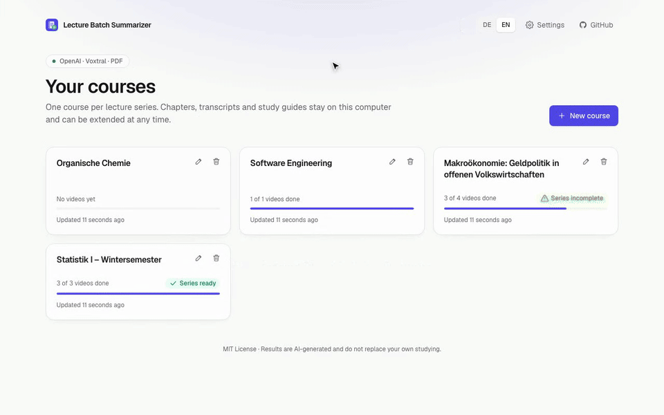
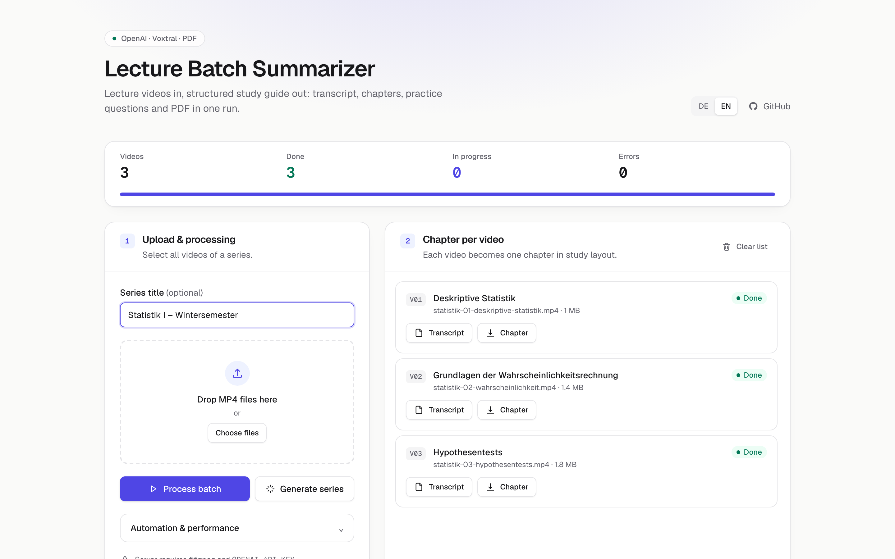
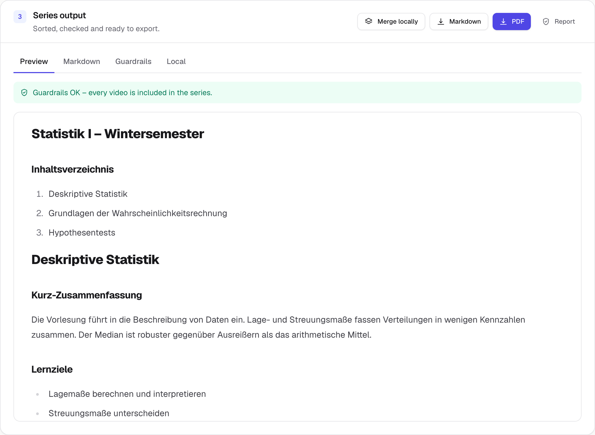
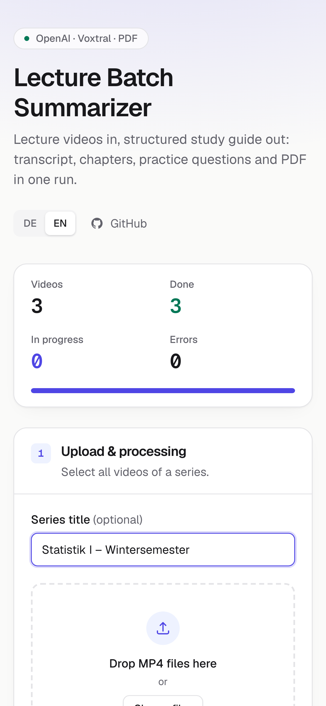
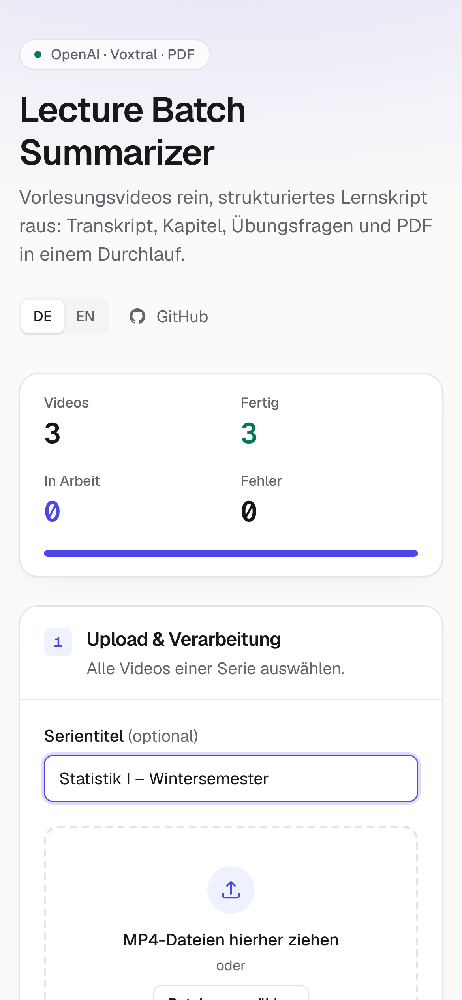
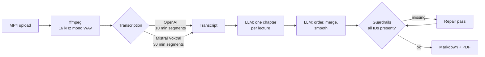

<div align="center">


# Lecture Batch Summarizer

**Turn a folder of lecture recordings into one polished study guide.**<br/>
Transcripts, structured chapters, practice questions and a print-ready PDF, in one run.

[](https://github.com/amroeser/lecture-notes-app/actions/workflows/ci.yml)
[](LICENSE)
[](https://nextjs.org/)
[](https://react.dev/)
[](https://www.typescriptlang.org/)
[](e2e/)

[Quick start](#quick-start) · [How it works](#how-it-works) · [Transcription providers](#transcription-providers) · [Configuration](#configuration) · [Testing](#testing)

<br/>

<a href="docs/media/demo-en.mp4">
  
</a>

<sub>▶ Watch the demo as MP4: <a href="docs/media/demo-en.mp4">English</a> · <a href="docs/media/demo-de.mp4">Deutsch</a></sub>

</div>

<br/>

## Why

Lecture recordings are long, and rewatching them before an exam is slow. This app turns a whole series of MP4 recordings into a single study guide with a fixed structure for every lecture: summary, learning objectives, sub-chapters, key points, glossary, worked examples, common mistakes and practice questions with answers. Chapters are then ordered by learning progression and checked so that no lecture goes missing.

## Product tour

<table>
  <tr>
    <td width="50%" valign="top">
      <b>Batch dashboard</b><br/>
      <sub>Drag in a series, watch every lecture move from queued to done. Light and dark mode follow your system.</sub><br/><br/>
      <picture>
        <source media="(prefers-color-scheme: dark)" srcset="docs/media/overview-en-dark.png" />
        
      </picture>
    </td>
    <td width="50%" valign="top">
      <b>Rendered study guide</b><br/>
      <sub>Preview the compiled series, edit the Markdown, inspect the guardrail report.</sub><br/><br/>
      <picture>
        <source media="(prefers-color-scheme: dark)" srcset="docs/media/preview-en-dark.png" />
        
      </picture>
    </td>
  </tr>
  <tr>
    <td width="50%" valign="top">
      <b>Print-ready PDF</b><br/>
      <sub>A4 export with headings, lists, tables and one page break per chapter.</sub><br/><br/>
      
    </td>
    <td width="50%" valign="top">
      <b>Mobile and bilingual</b><br/>
      <sub>Responsive down to phone width (tested at 390&nbsp;px). The UI speaks German or English, picked from the system language.</sub><br/><br/>
      <p align="center">
        
        &nbsp;
        
      </p>
    </td>
  </tr>
</table>

## Features

| | |
|---|---|
| **Batch processing** | Upload a whole series at once. Process 1 to 4 lectures in parallel. Files added mid-run join the queue. |
| **Fixed study layout** | Every lecture becomes the same chapter structure, so the guide reads like one book. |
| **Series compilation** | Chapters are ordered by learning progression, de-duplicated and smoothed. Large series use map-reduce. |
| **Guardrails** | Every lecture carries an ID marker. The final guide is checked, repaired once, and auto-download only happens when nothing is missing. |
| **Two transcription providers** | OpenAI (`gpt-4o-mini-transcribe` by default) or Mistral Voxtral (`voxtral-small-transcribe-3`). |
| **Smart caching** | Results are cached by file hash, model and prompt version, so re-runs cost nothing. |
| **Exports** | Per lecture: transcript and chapter. Per series: Markdown, PDF and the guardrail report as JSON. |
| **Polished UI** | Light and dark mode, German and English, keyboard accessible, checked with axe against WCAG 2.1 AA. |

## Quick start

> **Requirements:** Node.js 22 or 24 LTS, [ffmpeg](https://ffmpeg.org/) (`brew install ffmpeg` on macOS) and an [OpenAI API key](https://platform.openai.com/api-keys).

```bash
git clone https://github.com/amroeser/lecture-notes-app.git
cd lecture-notes-app
npm install
cp .env.example .env.local   # add OPENAI_API_KEY
./start.sh                   # http://localhost:3000
```

## How it works



1. **Upload.** Pick or drop the MP4 files of a series. Each file gets an ID (`V01`, `V02`, …).
2. **Transcribe.** ffmpeg extracts the audio. The selected provider transcribes it in German. Long recordings are split into segments; each segment gets the end of the previous one as context.
3. **Write chapters.** A text model turns each transcript into a chapter with the fixed study layout.
4. **Compile the series.** Chapters are ordered, merged and polished. Big series are compiled in chunks and merged again.
5. **Check and export.** Guardrails confirm every ID is present, then Markdown and PDF are ready.

<details>
<summary><b>Example chapter structure</b></summary>

```markdown
# Kapitel: Hypothesentests

## Kurz-Zusammenfassung
Ein Hypothesentest prüft, ob beobachtete Daten mit einer Nullhypothese vereinbar sind …

## Lernziele
- Null- und Alternativhypothese formulieren

## Unterkapitel
### Fehler 1. und 2. Art
- …

## Kernpunkte
## Begriffe & Definitionen
| Begriff | Definition |
|---|---|
| p-Wert | Wahrscheinlichkeit für mindestens so extreme Daten unter H₀ |

## Beispiele
## Typische Fehler/Missverständnisse
## Prüfungs-/Übungsfragen mit Antworten
1. Frage: Was misst der p-Wert?
   Antwort: …
```

</details>

## Transcription providers

Chapter and series generation always use the OpenAI-compatible text API. Only the transcription step is switchable.

| Provider | Setting | Default model | Notes |
|---|---|---|---|
| **OpenAI** | `TRANSCRIBE_PROVIDER=openai` (default) | `gpt-4o-mini-transcribe` | `gpt-4o-transcribe` for higher quality. Audio above 24 MB is sent in 10-minute segments (OpenAI's upload limit is 25 MB). |
| **Mistral Voxtral** | `TRANSCRIBE_PROVIDER=mistral` | `voxtral-small-transcribe-3` | Needs `MISTRAL_API_KEY`. Audio is sent in 30-minute segments and joined in order. `voxtral-mini-transcribe-3` is the cheaper option. |

```bash
# .env.local – transcribe with Voxtral, write chapters with OpenAI
TRANSCRIBE_PROVIDER=mistral
MISTRAL_API_KEY=...
OPENAI_API_KEY=sk-...
```

## Configuration

| Variable | Required | Default | Description |
|---|---|---|---|
| `OPENAI_API_KEY` | Yes | | Key for the text models, and for transcription with the OpenAI provider. |
| `OPENAI_BASE_URL` | No | OpenAI | Base URL for OpenAI-compatible providers. |
| `OPENAI_TEXT_API_KEY` / `OPENAI_TEXT_BASE_URL` | No | | Separate credentials for the text models. |
| `TRANSCRIBE_PROVIDER` | No | `openai` | `openai` or `mistral`. |
| `OPENAI_TRANSCRIBE_MODEL` | No | `gpt-4o-mini-transcribe` | Transcription model for the OpenAI provider. |
| `OPENAI_TRANSCRIBE_CHUNK_SECONDS` | No | `600` | Segment length for audio above 24 MB (minimum 60). |
| `MISTRAL_API_KEY` | With `mistral` | | Mistral API key. |
| `MISTRAL_BASE_URL` | No | `https://api.mistral.ai/v1` | Mistral API base URL. |
| `MISTRAL_TRANSCRIBE_MODEL` | No | `voxtral-small-transcribe-3` | Voxtral model. |
| `MISTRAL_TRANSCRIBE_CHUNK_SECONDS` | No | `1800` | Segment length in seconds (minimum 60). |
| `OPENAI_SUMMARY_MODEL` | No | `gpt-5.1-mini` | Model for chapter generation. |
| `OPENAI_SERIES_MODEL` | No | summary model | Model for ordering and compiling the series. |
| `OPENAI_SERIES_FINAL_MODEL` | No | series model | Model for the final reduce step of large series. |
| `SERIES_CHUNK_SIZE` | No | `4` | Chapters per chunk in map-reduce. |
| `MAX_SERIES_COMPILE_CHARS` | No | `60000` | Above this size the LLM compile step is skipped. |
| `CACHE_DIR` | No | `.cache/lecture-notes-app` | Filesystem cache. |

`.env.example` lists every variable with comments.

## Testing

The end-to-end suite runs against a production build in Chromium, on a desktop and a mobile viewport. The OpenAI and Mistral routes are mocked in the browser, so **tests never call a paid API**.

```bash
npx playwright install chromium   # once
npm run test:e2e                  # 26 tests: flows, errors, guardrails, i18n, layout, axe a11y
npm run lint && npm run typecheck
```

Covered: the full batch with auto-downloads, the non-MP4 filter, a failed lecture and its retry, the guardrail warning, Markdown editing, local merge, clearing the list, no horizontal overflow, WCAG 2.1 AA in light and dark mode, and language detection with manual override.

<details>
<summary><b>Regenerating the README media</b></summary>

Screenshots, the PDF preview and the demo videos are produced by Playwright from fixture data:

```bash
npm run media             # docs/media/*.png and raw recordings
scripts/build-media.sh    # MP4 + GIF via ffmpeg
```

</details>

## Project structure

```
src/
├── app/
│   ├── api/
│   │   ├── process-lecture/   # MP4 → audio → transcript → chapter
│   │   ├── series-summary/    # chapters → ordered, checked series
│   │   ├── series-pdf/        # Markdown → PDF (jsPDF)
│   │   └── _utils/            # cache, transcription providers
│   ├── layout.tsx
│   └── page.tsx
├── components/
│   ├── LectureNotesApp.tsx    # main UI
│   └── ui.tsx                 # buttons, cards, toggles, icons
└── i18n/                      # German/English messages, locale detection
e2e/                           # Playwright tests, fixtures, media capture
```

## Tech stack

Next.js 16 (App Router, Turbopack, React Compiler) · React 19 · Tailwind CSS 4 · TypeScript 6 · OpenAI SDK 7 · Mistral Voxtral · jsPDF 4 · react-markdown · Playwright + axe-core · ffmpeg

## Contributing

Issues and pull requests are welcome. Please run `npm run lint`, `npm run typecheck` and `npm run test:e2e` before opening a PR.

## Disclaimer

This project is provided **as is, without warranty**.

- Summaries depend on audio quality and the model used. **They can contain errors** and do not replace your own studying.
- API usage costs money. The author accepts **no liability for API charges**.
- Only upload recordings you **have the right to process**.
- Transcripts and summaries are cached on disk. Protect them like any other personal data.

## Author

**Alexander Maximilian Röser** · [GitHub @amroeser](https://github.com/amroeser) · [alexanderroeser.de](https://alexanderroeser.de)

## License

[MIT](LICENSE)
